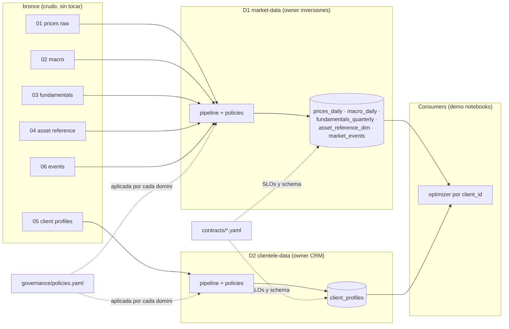

# Arquitectura Data Mesh (2 dominios) — Hackaton Credicorp `dataset_start`

> Demo simplificada de Data Mesh sobre el dataset. La línea de corte es la
> **naturaleza del dato**: *de mercado* (no depende del cliente) vs. *de cliente*
> (depende del cliente).

---

## 1. Principios Data Mesh aplicados al demo

| Principio | Cómo se cumple (aun con solo 2 dominios) |
|---|---|
| **Domain ownership** | Cada dominio tiene dueño, pipeline y limpieza propia. `VF-A1/ISS04` se arregla dentro de *market-data*; el encoding latin-1 dentro de *clientele-data*. |
| **Data as a product** | Cada dominio publica productos **curados** (no CSV crudos) con schema versionado y `contract.yaml`. |
| **Self-serve platform** | Una sola carpeta `platform/` (landing + transform + quality checks) reutilizada por ambos dominios. |
| **Federated governance** | `governance/policies.yaml` global (ID canónico, ISO-8601, UTF-8) **aplicado por cada dominio**, no por un equipo central. |

---

## 2. Los 2 dominios y sus data products

### Dominio 1: `market-data` — "Mesa de inversiones"

Owned by: *equipo de inversión/data eng de mercados*.
Todo el dato que **no depende del cliente**.

| Data product | Absorbe tablas | Granularidad | Frecuencia |
|---|---|---|---|
| `prices_daily.v1` | 01_market_prices_raw (+ 01_expanded opcional) | (asset_id, date) OHLCV | Diaria |
| `macro_daily.v1` | 02_macro_raw | (date) tasas, FX, factor, régimen | Diaria |
| `fundamentals_quarterly.v1` | 03_fundamentals_raw | (issuer_id, period_end) | Trimestral |
| `asset_reference_dim.v1` | 04_asset_reference | (asset_id) PK | On-change |
| `market_events.v1` | 06_events | (event_date, scope) | On-occurrence |

*(Un dominio puede publicar varios productos — es lo correcto en Data Mesh.)*

**Limpieza de dominio (queda aquí, no en consumidores):**
- Homologar alias `asset_id`: `VF-A1→VF_A01`, `VFA03→VF_A03`, `VF_A6/VF-A6→VF_A06`, `VF-A4→VF_A04`; `ISS04→ISS_04`; `Q4-2024`→fecha ISO.
- Normalizar fechas (ISO / MM/DD/YYYY) y timestamps fuera de rango del expanded.
- Outliers: `close=3,589`, `volume=99,999,999` → winsorizar/etiquetar (no eliminar).
- `us_inflation_yoy` con 258 nulos → forward-fill mensual.

### Dominio 2: `clientele-data` — "Banca / Asesoría"

Owned by: *owner CRM / front de asesores*.
Todo el dato que **sí depende del cliente**.

| Data product | Absorbe tablas | Granularidad | Frecuencia |
|---|---|---|---|
| `client_profiles.v1` | 05_client_profiles | (client_id) PK | On-change |

**Limpieza de dominio:**
- Encoding latin-1 → UTF-8 (documentado como fallo del *upstream source*, no del consumidor).
- Parsear `constraint` de texto libre a reglas numéricas:
  - CL_01 → `max_weight_per_sector = 0.45`
  - CL_02 → `max_weight_high_vol_assets = 0.25`
  - CL_03 → `min_countries = 3`, `min_sectors = 3`
- Ordenar `risk_tolerance` como ordinal: `Alta > Media > Media-Baja`.

---

## 3. Contratos de datos (`contracts/`)

Ejemplo del contrato del producto `prices_daily`:

```yaml
# contracts/market_data.contract.yaml (extracto)
product: prices_daily
version: 1.0.0
owner: market-data@credicorp-demo
grain: [asset_id, date]            # PK compuesta
schema:
  date:            {type: date, format: ISO8601}        # policy g-02
  asset_id:        {type: string, ref: asset_reference_dim.v1.asset_id}
  market:          {type: enum, values: [NASDAQ, NYSE, "NYSE ADR"]}
  currency:        {type: string, default: USD, nulls: 0}
  open/high/low:   {type: decimal(10,2), nulls: 0}
  close:           {type: decimal(10,2), nulls: 0, rules: [outlier_flagged]}
  volume:          {type: bigint, nulls: 0}
slos:
  freshness:        "T+1 09:15"
  completeness:     "8 activos x 100% días hábiles del calendario publicado"
consumers: [demo.optimizer, demo.event_impact]
```

Cliente equivalente:

```yaml
# contracts/clientele_data.contract.yaml (síntesis)
product: client_profiles
version: 1.0.0
owner: clientele-data@credicorp-demo
grain: [client_id]
schema:
  client_id:                   {type: string, PK}
  base_currency:               {type: enum, values: [USD, COP, PEN]}
  horizon_months:              {type: integer, min: 1}
  risk_tolerance:              {type: ordinal, order: [Alta, Media, "Media-Baja"]}
  max_drawdown_tolerance_pct:  {type: decimal, min: 0, max: 100}
  constraints_parsed:          {type: json, nulls: 0}   # reglas numéricas
slos:
  encoding:    UTF-8                      # policy g-03
  nulls:       0 en todas las llaves y numéricos
consumers: [demo.optimizer]
```

---

## 4. Gobernanza federada (`governance/policies.yaml`)

Reglas globales que **cada dominio aplica本地 en su pipeline** (validación peer-to-peer):

```yaml
policies:
  - id: g-01  id_canonico
    rule: "asset_id e issuer_id deben pertenecer al namespace canonico global (VF_A01..VF_A08, ISS_01..ISS_08)"
    # demostración de valor: los alias VF-A1, VFA03, ISS04 NO pasan la validación
  - id: g-02  formato_fecha
    rule: "Toda fecha en ISO 8601 (YYYY-MM-DD para fechas, con hora para ts intradia)"
    # demostración: el raw diario con 02/27/2026 queda eleado aquí
  - id: g-03  encoding
    rule: "UTF-8 en todos los productos (los sources pueden publicarse Latin-1)"
  - id: g-04  llaves_contractuales
    rule: "grain declarado en el contract == PK real de la tabla publicada (0 duplicados, 0 nulos)"
```

---

## 5. Estructura del repositorio

```
dataset_start/
├── data_dictionary.md              # (ya generado)
├── contracts/
│   ├── market_data.contract.yaml
│   └── clientele_data.contract.yaml
├── bronze/                          # CSVs crudos, sin tocar (inalterable)
├── platform/                        # self-serve: usada por ambos dominios
│   ├── transform.py                 # helpers (parse_fecha, utf8, canon_id)
│   └── quality_checks.py            # valida policies según contract
├── domains/
│   ├── market_data/
│   │   ├── pipeline.py              # limpia IDs, fechas, outliers
│   │   └── tables/                  # prices_daily, macro_daily, fundamentals_quarterly,
│   │                                # asset_reference_dim, market_events
│   └── clientele_data/
│       ├── pipeline.py              # encoding, parse de constraints
│       └── tables/                  # client_profiles
├── governance/
│   └── policies.yaml
└── demo/
    └── optimizer.py                 # consume ambos productos → portafolio por cliente
```

---

## 6. Flujo (diagrama de la demo)



---

## 7. Pitch: qué defender con 2 dominios

> "Aunque sea demo, los 4 principios de Data Mesh están presentes:
> 1. **Ownership** — `ISS04` y `VF-A1` se corrigen dentro de *market-data*; el encoding roto dentro de *clientele-data*. El problema se resuelve en el origen, no en un ETL central.
> 2. **Data product** — dos publicaciones curadas con contrato versionado y SLOs, no archivos CSV sueltos.
> 3. **Self-serve** — la plataforma (`transform.py`, `quality_checks.py`) es común y ambos dominios son sus usuarios.
> 4. **Gobernanza federada** — las políticas (`policies.yaml`) se validan en cada dominio, no hay un equipo central de calidad que 'arregle' los data products.
>
> Con solo 2 dominios ya se demuestra que el ownership está distribuido, la calidad es upstream y la gobernanza es federada."

## 8. Qué se perdió al reducir (aclarar en la presentación)

- **Asset Master** dejó de ser dominio propio: la tabla 04 vive como dimensión interna de *market-data*. En producción sería un dominio de instrumentos (referencias) al que todos apuntan.
- Múltiples dominios de análisis (macro, riesgo, investigación) quedaron consolidados en uno solo; en realidad serían equipos distintos.
- Los consumidores (optimizer, event impact) son notebooks de demo, no los productos de dominio de un "front-office".

---

## 9. Checklist para ejecutar el demo

1. Mover los 7 CSV → `bronze/` (sin modificar).
2. Escribir `platform/transform.py` y `platform/quality_checks.py`.
3. Implementar los pipelines de ambos dominios; correr quality checks (deben **fallar** pass antes de limpiar; corregir: pass verde).
4. Escribir `demo/optimizer.py`: leer ambos productos, convertir a moneda base del cliente vía FX de `macro_daily`, respetar constraints parseadas, reportar drawdown vs `max_drawdown_tolerance_pct`.
5. Preparar 3 slides: (a) dominios y contratos, (b) policies rompiendo el demo si se quita la limpieza, (c) output del optimizer.
