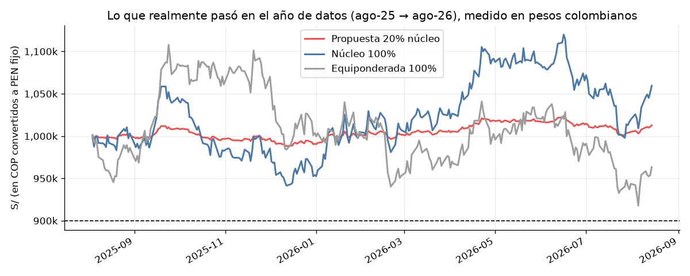
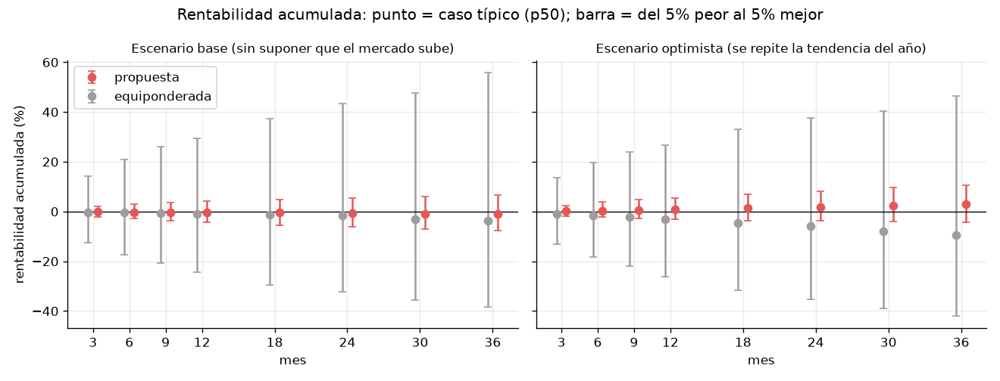
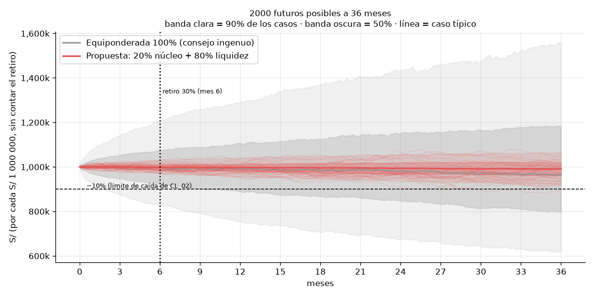

# Reporte financiero para no técnicos — CL_02: qué recomendamos, cuánto rinde y por qué

> Reproducible con `.venv/bin/python src/analysis/etapa4_rentabilidad.py`. Los gráficos están en `docs/img/etapa4_reporte/`.
> Datos: precios diarios del 2025-08-04 al 2026-08-14 (270 días). Los retornos se miden en **pesos colombianos (COP)**, la moneda de CL_02, y los montos se expresan sobre **S/ 1 000 000**.

## 0. En 30 segundos

CL_02 nos dijo tres cosas:
- **"No quiero perder más de 10%."**
- **"Voy a sacar 30% de mi dinero en 6 meses."**
- **"Mi horizonte es de 3 años."**

Con los activos disponibles, que oscilan entre 16% y 45% al año, invertir todo en partes iguales hace que esa promesa se rompa en **99,9% de los futuros simulados**.

**Nuestra recomendación:**

| Bloque | % | Monto |
|---|---|---|
| Núcleo defensivo: los 4 activos más estables | 20% | S/ 200 000 |
| Reserva en COP para el retiro | 30% | S/ 300 000 |
| Liquidez en COP | 50% | S/ 500 000 |

**Resultado:** el límite de −10% se cumple en el **95,7%** de los futuros simulados, frente al **0,1%** de repartir en partes iguales.

**La parte honesta:** la rentabilidad de esta cartera **no vendrá de las acciones**, sino de dónde se coloque la liquidez. Esa liquidez es el 80% del patrimonio (reserva más liquidez).

---

## 1. ¿Por qué CL_02 y no CL_01? (ni CL_03)

**Analogía:** un médico con tres pacientes atiende primero a quien tiene más riesgo **y** a quien el tratamiento genérico le haría más daño.

| | CL_01 "Crecimiento" | **CL_02 "Patrimonio estable"** | CL_03 "Regional" |
|---|---|---|---|
| Moneda | USD | **COP** | PEN |
| Pérdida máxima que tolera | 22% | **10%** | 15% |
| De 200 000 carteras al azar, cuántas respetan su límite | 33,8% | **0,01% (≈ 20 de 200 000)** | 11,2% |
| Si reparte en partes iguales, probabilidad de romper su límite | 29% | **92%** | 69% |
| Cuánto se pasa del límite, en promedio | 7% de su tolerancia | **85% de su tolerancia** | 35% |
| Shocks del twist que lo golpean | 0 | **2 (retiro 30% y COP −8%)** | 0 |

**Lectura no técnica:**
- **CL_01** acepta caídas de hasta 22% y casi cualquier cartera razonable le sirve. Nuestro análisis **cambiaría poco** su decisión.
- **CL_02** es el caso opuesto. Casi **ninguna** combinación de acciones respeta su límite, y el consejo genérico ("diversifica en partes iguales") lo lleva a perder casi el doble de lo que tolera. **Aquí los datos cambian la decisión**, y ese es el valor de nuestro trabajo.
- **CL_03** es el segundo candidato. Sus mejores carteras se concentran en EE. UU., lo que contradice su objetivo regional.

Este criterio se llama **valor de la información**: elegimos al cliente donde decidir con datos, en vez de "a ojo", ahorra más dinero.

---

## 2. Las métricas financieras que usamos, en palabras simples

| Métrica | Qué es (en simple) | Ejemplo | Por qué la usamos |
|---|---|---|---|
| **Caída máxima (max drawdown)** | La peor caída desde un pico hasta el punto más bajo siguiente | Si la cartera sube a S/ 1,05 M y luego baja a S/ 0,94 M, la caída máxima es −10,5% | **Es la promesa del cliente** ("no más de 10%"). La medimos en COP porque esa es la moneda en que vive |
| **Volatilidad** | Cuánto "se mueve" un activo en un año, típicamente | Una volatilidad de 20% significa que en un año normal el valor puede moverse ±20% | **Es lo único del pasado que se repite en el futuro.** El activo más movido de un semestre sigue siéndolo en el siguiente (correlación 0,93–0,98). Por eso elegimos el núcleo con ella |
| **Probabilidad de cumplir, P(caída ≤ 10%)** | De 2000 futuros simulados, en cuántos se respeta el límite | 95,7% = en 1914 de 2000 futuros la caída no pasa de 10% | Un solo año de historia es **un solo camino**; la probabilidad cubre muchos caminos posibles |
| **CVaR 95% (pérdida en el peor 5%)** | El promedio de lo que pasa en los 100 peores futuros de 2000 | CVaR −11% = en los peores escenarios la caída promedio es de 11% | Responde "¿y si sale mal?", que es lo que pregunta un cliente conservador |
| **Rentabilidad (retorno)** | Cuánto ganó o perdió la cartera en un periodo | +1,3% en el año = S/ 13 000 por cada millón | **Es lo que el cliente quiere ver**, pero el retorno pasado **no predice** el futuro (correlación ≈ 0). Lo reportamos, pero no decidimos con él |
| **Pérdida evitada (S/)** | La diferencia entre nuestra propuesta y el consejo ingenuo en el caso típico y en el malo | A 36 meses: S/ 224 407 típica y S/ 356 020 en el 10% de peores casos (caída máxima de la equiponderada − caída de la propuesta, mismo escenario) | Traduce el riesgo a dinero |
| ❌ **Sharpe, betas, "acción ganadora"** | Retorno por unidad de riesgo y sensibilidad a tasas o FX | — | **No los usamos para decidir.** Con un año de datos no son estables ni significativos, y una recomendación basada en ellos sería suerte |

---

## 3. Rentabilidad: horizonte de 36 meses, por trimestre y por año

### 3.1 Lo que realmente pasó en el año de datos (backtest, en COP)

| Trimestre | Propuesta (20% núcleo) | Núcleo al 100% | Equiponderada al 100% |
|---|---|---|---|
| 2025-T3 (ago–sep) | +0,9% | +4,6% | +8,5% |
| 2025-T4 | −1,8% | −8,8% | −7,5% |
| 2026-T1 | +1,6% | +8,1% | −2,8% |
| 2026-T2 | +0,7% | +3,3% | +1,4% |
| 2026-T3 (jul – 14 ago) | −0,1% | −0,6% | −2,6% |
| **Año completo (COP)** | **+1,3%** | +5,9% | −3,7% |
| **Peor caída del año** | **−2,3% ✅** | −11,1% ❌ | −17,2% ❌ |
| Año completo en soles | −2,4% | +2,1% | −7,2% |

*Nota:* aquí la equiponderada y el núcleo al 100% se compran y se mantienen, sin rebalanceo. En `sustentacion.md` §4 la equiponderada se rebalancea cada trimestre, y da −5,3% con caída de −19,0%. La conclusión es la misma.

**Cómo leerlo:**
- La propuesta ganó poco, pero **nunca estuvo cerca del límite**.
- El núcleo al 100% ganó más, pero **rompió la promesa** (−11,1%).
- La equiponderada perdió dinero **y** rompió la promesa.
- **En soles** el resultado es peor porque el peso colombiano se depreció 3,8% frente al sol durante el año. El riesgo se mide en COP porque el cliente gasta en COP.
- *Advertencia:* el núcleo se eligió con este mismo año, así que esto ilustra lo que pasó y **no** es una prueba. La prueba fuera de muestra es el walk-forward: la propuesta cumplió en 7 de 7 cortes.

### 3.2 Lo que puede pasar en los próximos 36 meses (Monte Carlo, 2000 futuros)

**Escenario base (conservador):**
- No suponemos que las acciones suban; solo conservamos su forma de moverse.
- La liquidez rinde 0%.

Rentabilidad **acumulada** de la propuesta (p50 = caso típico; p5 = 1 de cada 20 futuros sale peor que esto; p95 = 1 de cada 20 sale mejor):

| Horizonte | p5 (malo) | **p50 (típico)** | p95 (bueno) | Prob. de terminar en pérdida | Equiponderada p5 / p50 / p95 |
|---|---|---|---|---|---|
| 3 meses (1 trimestre) | −2,1% | **−0,1%** | +2,1% | 53% | −12,6% / −0,4% / +14,3% |
| 6 meses | −2,9% | **−0,3%** | +3,0% | 55% | −17,3% / −0,4% / +21,0% |
| 12 meses (1 año) | −4,3% | **−0,3%** | +4,1% | 55% | −24,5% / −1,1% / +29,4% |
| 24 meses | −6,2% | **−0,6%** | +5,4% | 57% | −32,4% / −1,7% / +43,5% |
| **36 meses (horizonte del cliente)** | −7,7% | **−0,9%** | +6,5% | 58% | −38,3% / −3,6% / +55,9% |

- **Cualquier trimestre aislado:** típico −0,1%, de −2,1% a +2,1%. 54% de los trimestres terminan en negativo.
- **Cualquier año aislado:** típico −0,3%, de −4,3% a +4,2%.
- **Anualizado a 36 meses:** típico −0,3% al año, de −2,7% a +2,1%.

**Escenario optimista:** se repite la tendencia del último año (el núcleo subió +6,3% al año). La liquidez sigue rindiendo 0%.

| Horizonte | p5 | **p50** | p95 | Prob. de pérdida |
|---|---|---|---|---|
| 3 meses | −1,8% | **+0,2%** | +2,4% | 44% |
| 12 meses | −3,2% | **+1,0%** | +5,4% | 35% |
| **36 meses** | −4,3% | **+2,9%** (≈ +1,0% al año) | +10,7% | 27% |

En este escenario la equiponderada termina en −9,5% en el caso típico a 36 meses, porque su tendencia del año fue negativa (−2,1% al año).

### 3.3 Dónde está la rentabilidad de verdad: la liquidez (80% del patrimonio)

El universo de datos **no trae tasa de interés en COP**. En el escenario base supusimos 0%, que es lo más conservador. Si la reserva y la liquidez se colocan en un depósito o fondo de liquidez en COP:

| Tasa anual de la liquidez (supuesto) | Rentabilidad a 36 m (p50) | Anualizada | S/ ganados por cada S/ 1 M | P(cumplir −10%) |
|---|---|---|---|---|
| 0% (base) | −0,9% | −0,3% | ≈ −9 000 | 95,7% |
| 2% | +3,9% | +1,3% | ≈ +39 000 | 99,7% |
| 4% | +8,9% | +2,9% | ≈ +89 000 | 100% |
| 6% | +14,0% | +4,5% | ≈ +140 000 | 100% |

**Regla práctica:** cada 1 punto de tasa en la liquidez suma ≈ 0,8 puntos de rentabilidad anual a la cartera, y además **reduce** el riesgo de romper el límite. La tasa concreta la fija el producto de liquidez que ofrezca Credicorp Capital. **No es una cifra de nuestros datos.**

**Mensaje para el cliente:** "Con 20% en acciones defensivas y 80% en liquidez remunerada en COP, cumplimos su promesa de no caer más de 10% con 95%+ de confianza, tenemos listo el retiro del mes 6 sin vender acciones en un mal momento, y su rentabilidad será, sobre todo, la tasa de la liquidez más un pequeño aporte del núcleo."

---

## 4. ¿Qué es la simulación Monte Carlo y cómo se lee el gráfico?

**Qué hacemos, paso a paso:**
1. Tomamos los 270 días reales de retornos de los activos, en COP.
2. Armamos un **futuro posible** de 36 meses (756 días hábiles) pegando **bloques de 10 días seguidos** elegidos al azar de esa historia. Usamos bloques, y no días sueltos, para conservar las rachas y el hecho de que los activos se mueven juntos. Esto se llama *block bootstrap*.
3. Sobre ese futuro aplicamos la estrategia:
   - 20% en el núcleo.
   - Rebalanceo cada trimestre.
   - Pago del retiro de 30% en el mes 6, desde la reserva en COP.
4. Repetimos todo **2000 veces**. Así obtenemos 2000 historias distintas de cómo podrían ir los 3 años.
5. En cada historia medimos la caída máxima y la rentabilidad, y contamos en cuántas se cumple la promesa.

**Cómo leer el gráfico:**
- **Línea gruesa:** el caso típico (mediana).
- **Banda oscura:** donde caen la mitad de los futuros.
- **Banda clara:** donde caen 9 de cada 10 futuros.
- **Líneas rojas finas:** 30 futuros individuales de la propuesta.
- **Línea punteada horizontal:** el límite de −10%.

**El mensaje visual:** el abanico gris (equiponderada) se abre hasta S/ 620 k en el peor 5% y cruza el límite muy pronto. El rojo (propuesta) se mantiene estrecho y por encima del límite.

**Supuesto clave:** "deriva cero" significa que **no** suponemos que el mercado sube ni baja; solo que se mueve como se movió. Lo elegimos porque el retorno pasado no predice el futuro en estos datos, y sería optimista asumir que el +6,3% del núcleo se repite.

---

## 5. Periodos de entrenamiento, validación y test (EWMA y LSTM)

### 5.1 EWMA: no se entrena

EWMA (*Exponentially Weighted Moving Average*, el método RiskMetrics de J.P. Morgan) estima la volatilidad de hoy como un promedio de los retornos al cuadrado, donde **el día más reciente pesa 6% y cada día anterior pesa 94% de lo que pesa el siguiente**:

σ²ₜ = 0,94 · σ²ₜ₋₁ + 0,06 · r²ₜ

- **λ = 0,94 no se estima con nuestros datos.** Es el valor estándar de la industria (RiskMetrics, 1996). Por eso **EWMA no tiene periodo de entrenamiento ni de validación**: no tiene nada que ajustar y no puede sobreajustarse.
- **Calentamiento:** usa todos los retornos disponibles **hasta el día t** (desde el 2025-08-05) y nunca mira el futuro.
- **Test:** se evalúa en **exactamente los mismos días y activos** que la LSTM, los meses de prueba del walk-forward (abajo). Así la comparación es justa.

### 5.2 LSTM: walk-forward con 5 cortes

Cada fila es un "examen". Se entrena con el pasado, se valida con el tramo más reciente del pasado (para decidir cuándo parar) y se examina con el mes siguiente, que nunca vio.

| Corte | Entrenamiento (origen de las secuencias) | Validación (early stopping) | Test (mes siguiente) | El objetivo de test termina |
|---|---|---|---|---|
| 1-feb-2026 | 29-sep-2025 → 18-dic-2025 | 19-dic-2025 → 01-ene-2026 | 02-feb → 27-feb-2026 | 30-mar-2026 |
| 1-mar-2026 | 29-sep-2025 → 12-ene-2026 | 13-ene → 29-ene-2026 | 02-mar → 31-mar-2026 | 29-abr-2026 |
| 1-abr-2026 | 29-sep-2025 → 06-feb-2026 | 09-feb → 02-mar-2026 | 01-abr → 30-abr-2026 | 29-may-2026 |
| 1-may-2026 | 29-sep-2025 → 05-mar-2026 | 06-mar → 01-abr-2026 | 01-may → 29-may-2026 | 29-jun-2026 |
| 1-jun-2026 | 29-sep-2025 → 30-mar-2026 | 31-mar → 30-abr-2026 | 01-jun → 16-jul-2026 | 14-ago-2026 |

**Detalles:**
- **¿Por qué el entrenamiento empieza el 29-sep-2025 si los datos empiezan el 04-ago?** Cada ejemplo necesita 21 días de historia y una volatilidad de al menos 21 días previos.
- **¿Por qué hay un hueco entre el fin de la validación y el corte?** Un ejemplo solo entra a entrenamiento si **sus 21 días futuros también terminan antes del corte**. Si no, el modelo "vería" el test.
- **Pre-entrenamiento** (solo la "LSTM pre-entrenada"): intradía del 02-ene-2020 al 01-ago-2025, que no se solapa con el test.
- La validación es el 15% más reciente de cada entrenamiento. Las fechas exactas por corte quedan en `credicorp_dq.gold.etapa4_lstm_particiones`.

### 5.3 Walk-forward de la decisión de exposición (etapa 3)

| Elemento | Qué se hizo |
|---|---|
| Cortes | 7, mensuales, del 1-dic-2025 al 1-jun-2026 |
| Entrenamiento | Todo lo anterior al corte. Con eso se eligen el núcleo (volatilidad ≤ 30%) y la exposición |
| Test | Todo lo posterior al corte, hasta el 14-ago-2026. Se mide si la caída real se mantuvo ≤ 10% |
| Resultado | La propuesta cumplió **7 de 7** veces; las carteras al 100% cumplieron 0 de 7 |
