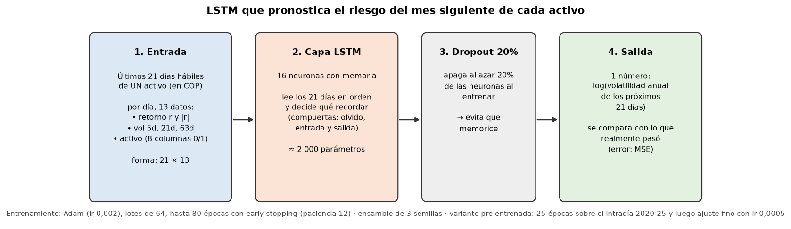
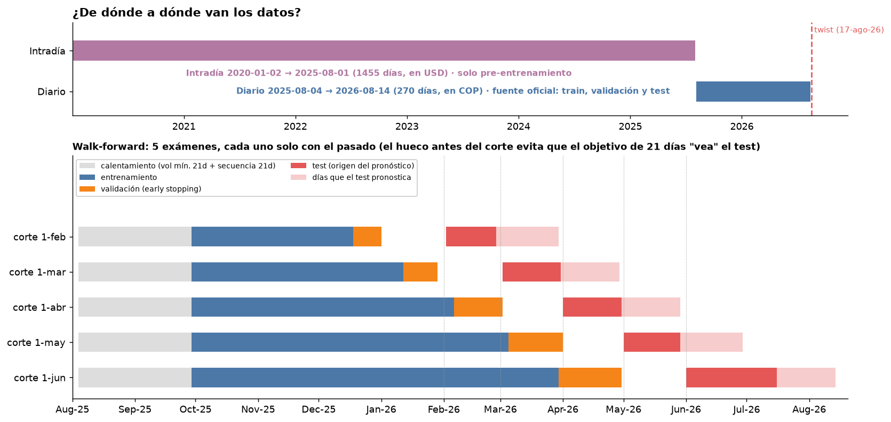
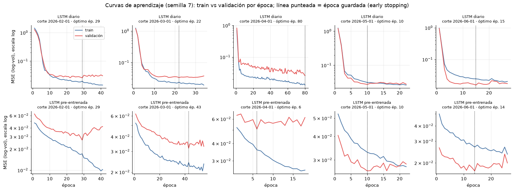
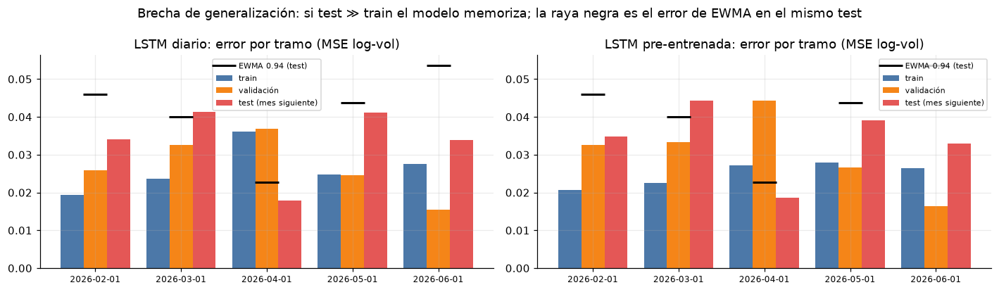
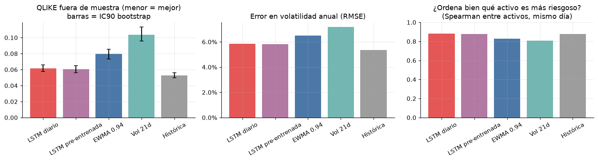
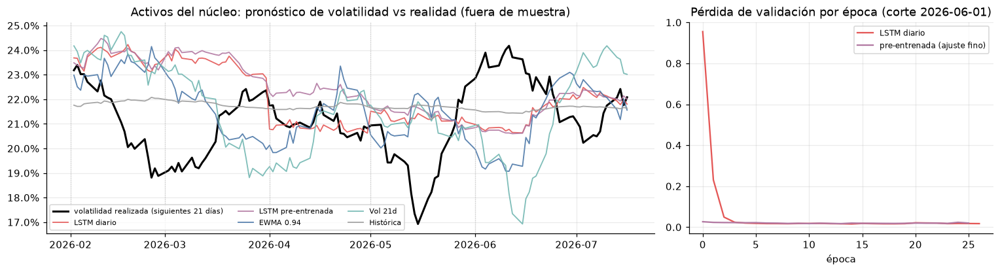

# Sustentación ante el jurado: Value Finders

> Guía para defender la solución en el pitch y en la ronda de preguntas. Cada punto trae la respuesta corta, la evidencia y dónde está en el repo.
> **Cifras:** recomendación vigente de [`etapa3_propuesta.md`](etapa3_propuesta.md) (simulador Monte Carlo a 36 meses). Calidad de datos de [`EDA.md`](EDA.md). Robustez de [`etapa2_reporte_cientifico_datos.md`](etapa2_reporte_cientifico_datos.md).
> **Moneda:** el riesgo de CL_02 se mide en **COP** (su moneda) y los montos se reportan en **S/** sobre un patrimonio de referencia de **S/ 1 000 000** (FX del 2026-08-14: USD/PEN 3,6802; USD/COP 4.195,52).
> **Leyenda:** ✅ implementado en el repo o en Databricks · 🔜 propuesto (diseñado, no construido).

---

## 0. El mensaje en 30 segundos

> "De los tres clientes elegimos al que más necesita análisis: CL_02, Patrimonio Estable, que no tolera perder más del 10%. Si se sigue el consejo ingenuo de repartir en partes iguales, rompe su límite en 9 de cada 10 escenarios. Nuestro hallazgo es que en estos datos **no se puede predecir qué acción ganará, pero sí cuánto riesgo tomar**. Por eso la decisión principal es cuánto invertir: 20% en un núcleo de acciones estables y 80% en liquidez en pesos, incluido el 30% que el cliente retirará en 6 meses. Así cumple su límite en el 95,7% de los escenarios a 3 años, frente al 0,1% de la opción ingenua."

| Cifra clave | Valor |
|---|---|
| Probabilidad de cumplir el límite de 10% a 36 meses (propuesta) | **95,7%** (equiponderada: 0,1%) |
| Peor caída en el 5% de escenarios más malos | −9,8% (CVaR 95%: −11,0%) |
| Pérdida evitada frente a la equiponderada (por S/ 1 000 000) | Mediana **S/ 137 725**; escenario adverso (p90) **S/ 229 404** |
| Validación sin mirar el futuro (walk-forward, 7 cortes) | **7 de 7** cumplen (equiponderada al 100%: 0 de 7) |
| Datos aprovechables tras la limpieza | **99,99%** (541 319 de 541 363 registros) |

---

## 1. Generar valor a partir de la data

**Respuesta corta:** convertimos un dataset sucio en una decisión con un valor medible en soles: le evitamos al cliente una pérdida mediana de S/ 137 725 por cada millón.

| Paso | De qué a qué | Evidencia |
|---|---|---|
| Confianza | 541 363 registros crudos con alias, fechas mixtas, `N/A`, un precio ×100 y duplicados → 99,99% aprovechable, con cada corrección registrada | `notebooks/EDA.ipynb` ✅, `silver.dq_log` ✅ |
| Señal | "¿Qué acción gana?" no tiene respuesta estable (el retorno no persiste, ρ ≈ 0). La volatilidad sí persiste (ρ 0,93–0,98) | `etapa3_propuesta.md` §2 ✅ |
| Decisión | La palanca es la **exposición**: 20% en el núcleo, 30% de reserva para el retiro y 50% de liquidez | `gold.etapa3_recomendacion_simulador` ✅ |
| Valor | P(cumplir) 95,7% frente a 0,1%; pérdida evitada mediana S/ 137 725 | Simulador Monte Carlo ✅ |

---

## 2. ¿Por qué CL_02? ¿Por qué no CL_01? ¿Por qué no CL_03?

**Criterio: valor de la información.** Elegimos al cliente donde decidir con datos se aleja más del consejo ingenuo y donde equivocarse cuesta más.

| | CL_01 Crecimiento (USD, tolera 22%) | **CL_02 Patrimonio Estable (COP, tolera 10%)** | CL_03 Regional (PEN, tolera 15%) |
|---|---|---|---|
| Carteras al azar (100% acciones) que cumplen | 33,8% | **0,01%** | 11,2% |
| Probabilidad de que repartir en partes iguales rompa el límite | 29% | **92%** | 69% |
| Cuánto se pasa del límite, en % de su tolerancia | 7% | **85%** | 35% |
| Lectura | El análisis cambia poco | **Los datos cambian la decisión** | Candidato #2 |

### Cómo leer esa tabla (pregunta trampa)
Las cifras de CL_02 son malas **a propósito**: miden **qué tan difícil es el problema sin análisis**, no la calidad de nuestra solución. Es como elegir al paciente para una demostración médica: no se elige el resfrío, se elige el caso donde el tratamiento genérico falla. Nuestra solución para CL_02 pasa de **92% de fallas a 95,7% de cumplimiento**.

### ¿Por qué no CL_01?
- Para él, **la intuición funciona**: si reparte en partes iguales, su peor caída es −21,7%, y tolera 22%.
- 1 de cada 3 carteras al azar ya cumple sus reglas. Cuando la opción ingenua falla, se pasa apenas un 7% de su tolerancia.
- **No lo abandonamos:** el mismo motor le genera su recomendación. Pero ahí el análisis aporta poco valor marginal.

### ¿Por qué no CL_03?
- Sí necesita análisis (la opción ingenua cae −23,2% frente a su 15%), por eso es el **candidato #2**.
- Pero su problema es menos crítico: 11,2% de carteras cumplen, frente a 0,01% de CL_02.
- **Tiene una contradicción de fondo:** sus mejores carteras se concentran en EE. UU. (VF_A05 es el único activo que cabe solo en su tolerancia), en contra de su objetivo de diversificación regional. Además, los activos latinoamericanos fueron los que más cayeron (VF_A03, VF_A06 y VF_A07, alrededor de −26%). Cumplir "3 países y 3 sectores" lo obliga a comprar perdedores.
- **El twist no lo toca:** 2 de los 3 shocks (retiro del 30% y COP −8%) apuntan a CL_02.

---

## 3. La recomendación

| Bloque | % del patrimonio | Monto |
|---|---|---|
| Núcleo defensivo: VF_A08 33% · VF_A01 27% · VF_A05 22% · VF_A04 19% (pesos por inversa de volatilidad) | **20%** | S/ 200 000 |
| Reserva para el retiro del mes 6 (TW_02), liquidez en COP | 30% | S/ 300 000 |
| Liquidez adicional en COP | 50% | S/ 500 000 |

**Regla de gestión:** rebalancear cada trimestre y al pagar el retiro, para volver a 20% en el núcleo.

**Por qué 20% y no más:** a más horizonte, más oportunidades de una caída grande. Para 95% de confianza la exposición máxima es 50% a 6 meses, 35% a 12, 25% a 18 y 24, y **20% a 36 meses** (el horizonte de CL_02). Antes proponíamos 28% calculado a 1 año, y lo corregimos: es un ejemplo de pensamiento crítico (§7).

---

## 4. Rentabilidad: por año, por trimestre y por qué

### Simulación a futuro (36 meses, 2000 escenarios)
- Patrimonio final más el retiro entregado (mediana): **S/ 992 534**. Con deriva cero, el escenario base no supone ganancias: mide el riesgo, no promete retorno.
- El detalle completo, con gráficos y la explicación para no técnicos, está en [`etapa4_reporte_financiero.md`](etapa4_reporte_financiero.md).

**Rentabilidad acumulada de la propuesta: caso típico (p50) y rango del 5% peor al 5% mejor**

| Horizonte | Base: deriva 0, liquidez 0% | Optimista: se repite la tendencia del año | Equiponderada (base) |
|---|---|---|---|
| 1 trimestre | −0,1% [−2,1%; +2,1%] | +0,2% [−1,8%; +2,4%] | −0,4% [−12,6%; +14,3%] |
| 1 año | −0,3% [−4,3%; +4,1%] | +1,0% [−3,2%; +5,4%] | −1,1% [−24,5%; +29,4%] |
| 2 años | −0,6% [−6,2%; +5,4%] | +1,9% [−3,8%; +8,1%] | −1,7% [−32,4%; +43,5%] |
| **36 meses** | **−0,9% [−7,7%; +6,5%]** | **+2,9% [−4,3%; +10,7%]** | −3,6% [−38,3%; +55,9%] |

**La palanca real de rentabilidad es la liquidez (80% del patrimonio).** Los datos no traen tasa en COP, así que la tasa es un supuesto:

| Tasa de la liquidez en COP | Rentabilidad a 36 m (p50) | Anualizada | P(cumplir −10%) |
|---|---|---|---|
| 0% | −0,9% | −0,3% | 95,7% |
| 2% | +3,9% | +1,3% | 99,7% |
| 4% | +8,9% | +2,9% | 100% |
| 6% | +14,0% | +4,5% | 100% |

Cada punto de tasa suma ≈ 0,8 pp al año **y** baja el riesgo de romper el límite.

### Lo que habría pasado el último año (backtest, en COP)
Supuestos: rebalanceo trimestral, la liquidez rinde 0%, sin retiro.

| Cartera | Rentabilidad del año | Peor caída | Valor final | Peor pérdida en el camino |
|---|---|---|---|---|
| Equiponderada al 100% | −5,3% | −19,0% ✗ | S/ 947 112 | S/ −189 702 |
| Núcleo al 100% | +6,1% | −11,1% ✗ | S/ 1 060 833 | S/ −111 087 |
| **Propuesta (núcleo 20% + 80% liquidez)** | **+1,3%** | **−2,3% ✓** | **S/ 1 013 303** | **S/ −22 990** |

| Trimestre | Propuesta | Equiponderada |
|---|---|---|
| ago–sep 2025 | +1,0% | +8,7% |
| oct–dic 2025 | −1,8% | −7,0% |
| ene–mar 2026 (incluye el estrés de feb.) | +1,6% | −4,4% |
| abr–jun 2026 | +0,7% | +0,6% |
| jul–14 ago 2026 | −0,1% | −2,6% |

### ¿Por qué gana poco?
1. **Es un cliente de preservación.** Su prioridad es "preservación + crecimiento moderado": primero no perder más del 10%, después crecer.
2. **El retorno no es predecible en estos datos** (ρ ≈ 0 entre periodos). Prometer más rentabilidad sería prometer algo que la evidencia no sostiene.
3. **La liquidez se modeló rindiendo 0%.** En la realidad estaría en depósitos o renta fija de corto plazo en COP, que suman su propio interés. Es un supuesto conservador.
4. **El costo de oportunidad existe y lo decimos:** si el mercado sube con fuerza, el cliente gana menos que con más acciones. Es el precio de dormir tranquilo.

---

## 5. Riesgo

**El riesgo que controlamos**
- Probabilidad de cumplir el límite a 36 meses: 95,7%. Peor 5% de escenarios: −9,8%.
- Twist: tasa +65 pb (como el estrés de feb-26) → −1,1% (S/ −10 723). Peor semana del intradía 2020-25 → −6,1% (S/ −61 498), dentro del límite. COP −8% → +2,2% en COP.
- El retiro del 30% se paga con liquidez: nunca hay que vender acciones en mal momento.

**Los riesgos que reconocemos**
1. **Un solo año de datos sintéticos**, con retornos casi normales: el riesgo real podría ser mayor. Lo mitigamos exigiendo 95% de confianza y probando el estrés del intradía.
2. **Un solo episodio de estrés** (10 días, idiosincrático): poca evidencia sobre crisis sistémicas.
3. **Sensibilidad a tasas no medible:** la tasa casi no se movió en el año. VF_A08 (utilities) no es un refugio garantizado.
4. **El drawdown histórico es muy incierto:** el de la equiponderada es −19%, con IC90 de [−31%; −9%]. Por eso decidimos con probabilidades, no con un solo número.
5. **Sesgo retrospectivo:** el núcleo se eligió sabiendo que VF_A02 cayó en febrero. Lo mitiga el walk-forward (7/7).

---

## 6. ¿Qué hacemos para que el cliente no se vaya?

Un cliente de preservación se va cuando **ve caer su dinero más de lo que aguanta** o cuando **no tiene la plata el día que la necesita**.

1. **No lo hacemos pasar el susto:** su peor pérdida del año habría sido S/ 23 mil, frente a S/ 190 mil con la opción ingenua.
2. **Su retiro está asegurado:** el 30% ya está apartado en COP, la moneda en que lo va a gastar.
3. **Expectativas claras desde el día uno:** "va a ganar menos que en un año muy bueno, pero no va a perder más del 10%".
4. **Monitoreo con semáforo:** si la caída se acerca al límite, se reduce exposición antes de romperlo (umbrales a acordar con el cliente). La regla se recalcula sola con datos nuevos.
5. **Reportes en su moneda y en lenguaje simple**, para que el tipo de cambio no lo confunda.
6. **Exposición gradual:** si el mercado se estabiliza y el retiro ya pasó, el simulador recalcula cuánto más puede invertir.

> "No le vendemos rentabilidad: le vendemos tranquilidad, con evidencia."

---

## 7. Pensamiento crítico: lo que descartamos y corregimos

| Hipótesis o supuesto | Qué encontramos | Qué hicimos |
|---|---|---|
| "El tipo de cambio decide el riesgo de CL_02 y CL_03" | Mueve el drawdown solo 1–2 pp (betas con R² ≤ 1%) | **Descartada** como señal; sí se usa para medir en moneda base |
| "Hay que elegir las acciones ganadoras" | El retorno no persiste (ρ ≈ 0); la cartera optimizada en train cumple 0/7 en test | La decisión pasa a ser **cuánto invertir** |
| "El intradía es 5 años más de historia" | Contradice al diario (correlación ≈ 0,06) y su estructura es otra (correlación entre activos 0,80 frente a 0,16) | Lo usamos **solo como escenario de estrés** |
| "Las correlaciones permiten optimizar pesos" | La correlación por par es ruido (0,04 entre train y test) | Pesos simples (inversa de volatilidad), no optimizados |
| "Los eventos explican los precios" | La dirección coincide en 4/5, pero solo 1/5 es significativo | Son contexto, no señal |
| "28% de exposición alcanza" | Se calculó a 1 año; el horizonte es de 36 meses | **Corregimos a 20%** |
| "Una LSTM pronosticará mejor el riesgo" | Hipótesis H2 con criterio de éxito fijado **antes** de entrenar (mejorar 10% a EWMA y cambiar la decisión) | **Rechazada.** Supera a EWMA en +24% de QLIKE, pero la volatilidad histórica simple le gana en 16% y no cambia ni el núcleo ni el 20%. Se mantiene la regla simple (ver Anexo A) |
| Datos del diccionario | El intradía va de 2020 a 2026 (no 2020-2022) y el diario termina el 2026-08-14 | Documentado en el EDA |
| Ratio de apalancamiento | Una versión usaba EBITDA trimestral y sobrestimaba 4 veces | Corregido a EBITDA LTM (A06: 0,68x) |

---

## 8. Soluciones nuevas

1. **La exposición como variable de decisión.** En vez de buscar la cartera perfecta (casi no existe para CL_02), decidimos cuánto invertir con una probabilidad explícita de cumplir.
2. **Criterio formal para elegir al cliente:** "valor de la información" (escasez, probabilidad de falla de la heurística y severidad).
3. **Simulador Monte Carlo interactivo** ✅: el asesor cambia horizonte, exposición, confianza, rebalanceo, retiro y shocks, y ve la nueva recomendación. Permite conversar con el cliente con números.
4. **El intradía contradictorio convertido en prueba de estrés**, en lugar de descartarlo sin más.
5. **IA con criterios fijados antes de entrenar** ✅: LSTM con y sin pre-entrenamiento, comparada con las líneas base de la industria (histórica, vol 21d, EWMA) y registrada en MLflow.

---

## 9. ¿Por qué elegimos esta metodología?

| Elección | Por qué | Alternativa descartada |
|---|---|---|
| **Max drawdown en COP** como objetivo | Es lo que el cliente declaró tolerar, en su moneda | Volatilidad o VaR: no es lo que el cliente siente |
| **P(DD ≤ 10%)** con bootstrap por bloques | Un año es un solo camino; la probabilidad mide la incertidumbre. Los bloques conservan rachas y co-movimientos | Un único backtest: es una sola historia |
| **Walk-forward** (7 cortes) | Prueba sin mirar el futuro | Validar con los mismos datos de ajuste |
| **Monte Carlo a 36 meses** | Es el horizonte del cliente | Medir a 1 año subestimaba el riesgo (28% → 20%) |
| **Deriva cero** en el escenario base | El retorno no persiste; suponer que seguirá ganando favorece artificialmente al núcleo | Deriva histórica (+6,3%/año del núcleo) |
| **Núcleo por volatilidad, pesos por inversa de volatilidad** | La volatilidad es la única métrica que persiste (ρ 0,93–0,98) | Markowitz u optimización por retorno: sobreajusta (0/7) |
| **Rebalanceo trimestral** | Mantiene la exposición objetivo sin operar en exceso | Compra y mantiene: la exposición se desvía |

---

## 10. Arquitectura

```
CSV (7 fuentes) → Volume landing → bronze (texto, sin transformar + linaje)
               → silver (tipado, limpio, cuarentena, dq_log, restricciones Delta)
               → gold (hechos y métricas de negocio, etapa2_*, etapa3_*, etapa4_*)
               → consumo: Dashboard AI/BI · simulador Monte Carlo · pitch · (Genie 🔜)
```

| Pieza | Estado | Dónde |
|---|---|---|
| Unity Catalog `credicorp_dq` con esquemas bronze, silver y gold, y Volume de aterrizaje | ✅ | `databricks/00_setup.py` |
| Bronze: todo como texto, `_source_file` e `_ingest_ts` | ✅ | `databricks/01_bronze.py` |
| Silver: reglas, `_dq_fixes` por fila, tablas `*_quarantine`, `dq_log`, restricciones Delta y validación que detiene el pipeline | ✅ | `databricks/02_silver.py` |
| Gold: precios, riesgo, ratios, eventos, cliente × activo, scorecard de calidad | ✅ | `databricks/03_gold.py` |
| Validación y reporte de calidad | ✅ | `databricks/04_validacion.py`, `05_reporte_calidad.py` |
| Dashboard AI/BI | ✅ | `databricks/06_dashboard.py` |
| Arquitectura data mesh con 2 dominios (`market-data`, `clientele-data`) | ✅ diseño | `docs/data_mesh_architecture.md` |
| Bundle de Databricks (despliegue como código) | ✅ configuración base | `databricks.yml` |

---

## 11. Integración con los sistemas de la empresa (y optimización)

| Sistema | Qué aporta o recibe | Cómo se integra |
|---|---|---|
| Mesa de inversiones / proveedor de mercado | Precios diarios e intradía | Archivos al Volume → bronze. Para carga continua: Auto Loader incremental 🔜 (anotado en `01_bronze.py`) |
| Proveedores macro (tasas, FX) | Tipo de cambio de cierre, régimen | Igual que mercado. En Perú, el TC de referencia es el de cierre publicado por la SBS |
| Contabilidad / fuentes de fundamentales | Estados financieros trimestrales | Producto `fundamentals_quarterly.v1` del dominio `market-data` |
| CRM / asesores (`clientele-data`) | Perfil, tolerancia y restricciones del cliente | Producto `client_profiles.v1`, con restricciones parseadas a números |
| Asesor y cliente | Recomendación, simulador, dashboard | Tablas gold, dashboard AI/BI ✅; publicar la recomendación al CRM como tabla o API 🔜 |

**Optimización**
- **De la cartera:** no optimizamos pesos por retorno (sobreajusta). Optimizamos la **exposición máxima** que cumple el límite con 95% de confianza. Es más robusto y explicable.
- **Del cómputo:** el volumen es pequeño (~0,5 M filas), así que alcanza el cómputo serverless. Para crecer: carga incremental, Liquid Clustering por `asset_id` y `date`, y orquestación como Job 🔜.

---

## 12. Escalabilidad

| Si crece… | Qué ya está preparado |
|---|---|
| **Más clientes** | El motor lee tolerancia, moneda y restricciones del perfil; `gold.client_asset_fit` ya cruza todos los clientes con todos los activos |
| **Más monedas** | El macro ya trae COP, PEN, MXN y CLP; la conversión es genérica por moneda base |
| **Más activos o más datos** | Spark y Delta escalan; los IDs se normalizan por regex, no por lista fija |
| **Más frecuencia** | Bronze aguanta carga incremental (Auto Loader 🔜) y silver es idempotente (`overwrite`) |
| **Más equipos** | Data mesh: cada dominio es dueño de su limpieza y de sus productos |

---

## 13. Gobernanza

- **Catálogo único** (Unity Catalog ✅): permisos, comentarios por tabla, búsqueda.
- **Políticas federadas** (data mesh): ID canónico, fechas ISO-8601 y UTF-8, aplicadas por cada dominio.
- **Contratos de datos:** productos versionados (`.v1`) con esquema (`contract.yaml` en el diseño).
- **Calidad bloqueante** ✅: si silver no pasa la validación final, el pipeline se detiene antes de gold.
- **Restricciones Delta** ✅: `ohlc_coherente` y `volumen_no_negativo`; cualquier escritura que las viole falla.
- **Experimentos auditables** ✅: los modelos se registran en MLflow (etapa 4).

---

## 14. Capa semántica y modelo ontológico

**Capa semántica 🔜:** un modelo en estrella sobre gold y **metric views de Unity Catalog**. Cada métrica (drawdown en moneda base, P(cumplir), pérdida en S/) se define **una sola vez**, y la usan igual el dashboard, Genie y el pitch.

**Modelo ontológico: las entidades del negocio y cómo se relacionan**

| Entidad | Qué es | Relaciones |
|---|---|---|
| **Cliente** | Persona con patrimonio, moneda base, horizonte, tolerancia y restricciones | tiene una **Cartera**; mide su riesgo en una **Moneda** |
| **Activo** | Acción invertible (VF_A01…VF_A08) | pertenece a un **Emisor**, un **Sector** y un **País**; cotiza en una **Moneda** |
| **Emisor** | Empresa detrás del activo (ISS_01…ISS_08) | publica **Fundamentales** trimestrales |
| **Evento** | Noticia con severidad | afecta a un **Activo** o a un **Sector** |
| **Régimen** | Estado del mercado (Normal / Stress / Recovery) | califica cada **Fecha** |
| **Moneda / Tipo de cambio** | USD, COP, PEN, MXN, CLP | convierte precios a la moneda del **Cliente** |
| **Cartera** | Pesos por activo + exposición + liquidez | se evalúa en **Escenarios** |
| **Escenario** | Histórico, bootstrap, shock del twist | produce **Métricas** (DD, P(cumplir), pérdida en S/) |

Modelo de datos propuesto: `dim_cliente`, `dim_activo`, `dim_fecha`, `dim_evento` y los hechos `fact_precio_diario`, `fact_fx_diario`, `fact_cliente_activo_diario` (riesgo en moneda base y monto en S/ en la misma fila), `fact_fundamentales_trim` y `fact_escenario_cartera` (la recomendación como dato).

---

## 15. Linaje

| Nivel | Cómo se rastrea | Estado |
|---|---|---|
| Archivo → fila | `_source_file` e `_ingest_ts` en bronze | ✅ |
| Fila → corrección | `_dq_fixes` (qué reglas se le aplicaron) y `imputed_period` en fundamentales | ✅ |
| Regla → volumen | `silver.dq_log`, acumulado por corrida | ✅ |
| Tabla → tabla, columna → columna | Linaje automático de Unity Catalog | ✅ (nativo) |
| Modelo → datos → resultado | Corridas de MLflow con parámetros y veredicto | ✅ (etapa 4) |

---

## 16. Normas de calidad y estandarización de procesos

- **Reglas estándar** (mismas en el EDA y en silver): homologar IDs por regex, fechas a ISO, expandir sufijos K/M/B, `N/A` como nulo, currency desde el maestro, close ×100 → ÷100, una fila por llave, inflación con forward-fill, trimestres no ISO por secuencia (marcados).
- **Qué no se imputa, a propósito:** close nulo del intradía (cuarentena), cash de ISS_07, revenue anómalo de ISS_06 (se marca y queda fuera de ratios).
- **Ciclo estándar:** los chequeos **fallan** en bronze y **pasan** en silver, y eso queda visible.
- **Métricas de calidad:** 99,91% de registros limpios, 0,08% corregidos con regla, 0,008% descartados.

---

## 17. Custodiar el modelo empresarial

- **Dueños claros:** cada dominio (mercado, clientes) es responsable de su limpieza y sus productos.
- **Una sola definición por métrica** (capa semántica 🔜): nadie recalcula el drawdown "a su manera".
- **Versionado:** código en git con una rama por línea de trabajo; productos de datos `.v1`; modelos en MLflow.
- **Decisiones documentadas** con su evidencia: `etapa2_resumen.md`, `etapa2_reporte_cientifico_datos.md`, `etapa3_propuesta.md`.
- **Reproducibilidad:** semillas fijas, scripts que regeneran cada cifra y notebooks que corren en local y en Databricks.

---

## 18. Entender con el equipo de negocio

- **Todo se traduce a soles** y al lenguaje del cliente ("cuánto podría perder", no "drawdown").
- **Guía para no expertos:** `etapa2_guia_junior.md` y el glosario (§23).
- **La pregunta guía manda:** cada análisis responde a "qué recomendar hoy y con qué evidencia".
- **El simulador** permite que el asesor explore escenarios con el cliente sin escribir código.

---

## 19. Habilidades de desarrollo

Python (pandas, NumPy, PyTorch), PySpark y SQL sobre Delta Lake; Unity Catalog; notebooks de Databricks con widgets; MLflow; Databricks Bundles; git con ramas por línea de trabajo; validaciones automáticas en el pipeline.

---

## 20. Analítica avanzada, BI e insights

| Herramienta | Insight que entrega |
|---|---|
| Dashboard AI/BI ✅ | Qué ocurre, qué lo explica, qué significa para el cliente, qué hacer y qué podría cambiarlo |
| Simulador Monte Carlo ✅ | Cuánto invertir según horizonte, confianza y shocks |
| Bootstrap y walk-forward ✅ | Qué tan robusta es la recomendación |
| LSTM frente a EWMA ✅ | Si la IA aporta o no a la decisión, con criterios previos |
| Genie sobre metric views 🔜 | Preguntas en lenguaje natural con métricas gobernadas |

**Insights principales:** solo 2 de 8 activos generaron valor; el retorno no persiste y la volatilidad sí; el estrés de feb-26 fue idiosincrático; el riesgo depende más de cuánto se invierte que de en qué.

---

## 21. Buenas prácticas y cultura data-driven

1. **Hipótesis antes de modelar**, con unidad de análisis definida.
2. **Criterios de éxito fijados antes de entrenar** (LSTM).
3. **Sin mirar el futuro:** walk-forward y twist tratado como escenario, no como dato histórico.
4. **Resultados honestos:** reportamos lo que no funcionó y lo que corregimos.
5. **Decidir con probabilidades,** no con un solo número.
6. **Lo simple gana si rinde igual:** más transparente, auditable y explicable para el cliente.

---

## 22. ¿Qué ejecuciones hay que correr para encontrar valor?

| # | Ejecución | Qué responde | Dónde |
|---|---|---|---|
| 1 | Perfilado y calidad (EDA) | ¿Podemos confiar en los datos? ¿Cuánto se salva? | `notebooks/EDA.ipynb` ✅ |
| 2 | Pipeline bronze → silver → gold con validación | ¿Los datos curados cumplen las reglas? | `databricks/01`–`04` ✅ |
| 3 | Escaneo de factibilidad (200 000 carteras al azar) | ¿Qué cliente tiene el problema más difícil? | `notebooks/etapa2_find_the_signal.py` ✅ |
| 4 | Pruebas de hipótesis (colas, autocorrelación, regímenes, betas) | ¿Hay patrones explotables? | `src/analysis/etapa2_ds_review.py` ✅ |
| 5 | Bootstrap por bloques | ¿Con qué probabilidad se cumple el límite? | etapa 2 y 3 ✅ |
| 6 | Walk-forward (7 cortes) | ¿Funciona sin mirar el futuro? | `notebooks/etapa3_propuesta_cl02.py` ✅ |
| 7 | Pruebas de estrés (estrés de feb-26, peor semana del intradía, twist) | ¿Aguanta lo peor? | etapa 2 y 3 ✅ |
| 8 | Monte Carlo al horizonte del cliente | ¿Cuánto invertir a 36 meses? | `notebooks/etapa3_simulador_montecarlo_cl02.py` ✅ |
| 9 | Retador de ML frente a líneas base | ¿La IA mejora la decisión? | `notebooks/etapa4_lstm_volatilidad_cl02.py` ✅ |
| 10 | Corrida periódica con datos nuevos + semáforo | ¿Hay que ajustar la exposición? | Orquestación como Job 🔜 |

---

## 23. Glosario

**Códigos del dataset**

| Código | Qué es |
|---|---|
| **VF_A01 … VF_A08** | Identificadores de los 8 activos (acciones) invertibles. "VF" es el prefijo del dataset del reto (Value Finders) |
| **ISS_01 … ISS_08** | Emisor: la empresa detrás de cada acción (ISS_05 emite VF_A05) |
| **CL_01, CL_02, CL_03** | Los 3 clientes |
| **TW_01, TW_02, TW_03** | Los shocks del twist: tasa +65 pb, retiro del 30% en 6 meses, COP −8% |

| Activo | Empresa | Sector | País |
|---|---|---|---|
| VF_A01 | Andes Consumer | Consumo básico | Colombia |
| VF_A02 | Pacifica Digital | Tecnología | Perú |
| VF_A03 | Cordillera Energy | Energía | Colombia |
| VF_A04 | Lima Financial | Financiero | Perú |
| VF_A05 | Aurora Health | Salud | EE. UU. |
| VF_A06 | Norte Industrials | Industrial | México |
| VF_A07 | Sierra Materials | Materiales | Chile |
| VF_A08 | Atlas Utilities | Servicios públicos | EE. UU. |

**Inversión**

| Término | En palabras simples |
|---|---|
| Rentabilidad (retorno) | Cuánto ganó o perdió la inversión, en % |
| Volatilidad | Cuánto "salta" el precio día a día |
| Alta volatilidad | Supuesto nuestro: más de 30% anual (VF_A02, VF_A03, VF_A06, VF_A07) |
| Drawdown / max drawdown | Caída desde el punto más alto / la peor caída del periodo |
| Tolerancia | Caída máxima que el cliente acepta (CL_02: 10%) |
| CVaR 95% | Caída promedio en el peor 5% de los escenarios |
| Exposición | Qué parte del dinero está en acciones; el resto queda en liquidez |
| Liquidez | Dinero disponible al instante (efectivo, depósitos de corto plazo) |
| Núcleo defensivo | VF_A01, VF_A04, VF_A05 y VF_A08: las acciones más estables |
| Inversa de volatilidad | Dar más peso a la acción más estable |
| Cartera equiponderada | Repartir en partes iguales entre las 8 acciones (el consejo ingenuo) |
| Rebalancear | Volver a los porcentajes objetivo cada cierto tiempo |
| ADR | Acción de una empresa extranjera que se compra en EE. UU. y en dólares |
| Moneda base | Moneda en que el cliente mide su riqueza |
| Tipo de cambio (FX) | Cuántos pesos o soles cuesta un dólar |
| pb / pp | Puntos básicos (100 pb = 1%) / puntos porcentuales |
| Régimen | Estado del mercado ese día: Normal, Stress o Recovery |
| Beta | Cuánto se mueve una acción cuando se mueve el mercado |
| Correlación | Qué tanto se mueven juntas dos acciones (de −1 a 1) |
| Retorno anormal (CAR) | Movimiento de una acción por un evento, descontando el mercado |
| EBITDA / LTM | Ganancia operativa / suma de los últimos 12 meses |
| Deuda neta / EBITDA | Años de ganancia que necesitaría la empresa para pagar su deuda |

**Método y datos**

| Término | En palabras simples |
|---|---|
| Bootstrap por bloques | Simular miles de "años alternativos" reordenando tramos de los datos reales |
| Monte Carlo | Simular muchas trayectorias futuras para medir probabilidades |
| Walk-forward / fuera de muestra | Elegir con el pasado y comprobar con datos que el modelo no vio |
| Deriva | Tendencia de ganancia supuesta en la simulación (usamos cero) |
| EWMA | Método estándar de la industria para estimar volatilidad, que pesa más los días recientes |
| LSTM | Red neuronal para secuencias; la probamos para pronosticar volatilidad |
| QLIKE | Métrica para evaluar pronósticos de riesgo; castiga más subestimarlo |
| Bronze / silver / gold | Capas de datos: crudo → limpio → listo para el negocio |
| Cuarentena | Tabla donde quedan las filas que no se pueden corregir |
| Linaje | Rastro de dónde viene cada dato y qué le pasó |
| Metric view | Definición única y gobernada de una métrica en Unity Catalog |
| Genie | Asistente de Databricks para preguntar a los datos en lenguaje natural |

---

## Anexo A. La LSTM: cómo se ve, con qué datos se entrenó y cómo defenderla

> Notebook: `notebooks/etapa4_lstm_volatilidad_cl02.py` (en Databricks: `hackaton-credicorp/09_lstm_volatilidad_cl02`). Tablas: `gold.etapa4_lstm_metricas`, `_predicciones`, `_sobreajuste`, `_particiones`, `_decision`. MLflow: experimento `/Users/<usuario>/ccg_etapa4_lstm_vol_cl02`; modelo registrado en `credicorp_dq.gold.lstm_vol_cl02`. Diagramas: `src/analysis/etapa4_lstm_diagramas.py`.

### A.1 Defensa en 30 segundos
> "La LSTM no la usamos para elegir acciones, porque el retorno no se puede predecir en estos datos. La usamos para la única pregunta donde podía aportar: **¿podemos anticipar el riesgo del mes siguiente y ajustar cuánto invertir?** Fijamos el criterio de éxito antes de entrenar: mejorar al estándar de la industria (EWMA de RiskMetrics) en al menos 10% **y** cambiar la decisión del cliente. La LSTM mejora a EWMA en 24%, pero el promedio histórico simple le gana y la decisión no cambia. Por eso recomendamos la regla simple: es igual de buena, más barata y más explicable. **La IA sirvió para validar la decisión, no para adornarla.**"

### A.2 Qué es la LSTM (en simple)



- Una **LSTM** (*Long Short-Term Memory*) es una red neuronal que **lee una serie en orden, día por día, y decide qué recordar y qué olvidar**, como un analista que revisa las últimas 3 semanas de un activo antes de opinar.
- **Unidad de análisis:** activo × día (8 activos), con retornos en COP.
- **Qué recibe:** los últimos **21 días hábiles** de un activo. Por cada día recibe 13 datos:
  - el retorno y su valor absoluto;
  - la volatilidad de 5, 21 y 63 días;
  - qué activo es (8 columnas de 0 y 1).
- **Qué predice:** el **logaritmo de la volatilidad anualizada de los próximos 21 días**, es decir, el riesgo del mes que viene.
- **Por qué volatilidad y no precio:** la volatilidad es lo único que persiste (ρ 0,93–0,98) y es lo que mueve la decisión de cuánto invertir. El precio y el retorno no se pueden pronosticar en estos datos (ρ ≈ 0).
- **Por qué el logaritmo:** la volatilidad siempre es positiva y asimétrica. En logaritmo, equivocarse ×2 hacia arriba pesa igual que hacia abajo, y el modelo entrena de forma más estable.
- **Tamaño:** 1 capa LSTM de 16 neuronas, unos 2000 parámetros. Es pequeña a propósito, porque solo hay 1840 secuencias diarias y una red grande memorizaría.

### A.3 ¿Qué es el "intradía" y qué significa "pre-entrenada"?

| Término | Qué es |
|---|---|
| **Diario** | `01_market_prices_raw.csv` (silver: `market_prices_daily`): 1 precio de cierre por día y activo, del **2025-08-04 al 2026-08-14** (270 días). Es la **fuente oficial**: con ella se entrena, se valida y se evalúa |
| **Intradía** | `01_market_prices_raw_expanded.csv` (silver: `market_prices_intraday`): precios **dentro del día**, del **2020 al 2026**. Para la LSTM lo convertimos a 1 cierre por día y usamos solo el tramo **anterior** al diario: **2020-01-02 → 2025-08-01** (1455 días). Está en USD porque no hay tipo de cambio para esas fechas |
| **Por qué no usamos el intradía como dato principal** | **Contradice al diario** en las fechas en que se solapan (correlación de retornos ≈ 0,06). No podemos tratarlo como la misma historia de precios |
| **Por qué sí sirve para pre-entrenar** | Tiene algo que al diario le falta: **rachas de volatilidad** (efecto ARCH, p < 0,001; en el diario p ≥ 0,08). No le pedimos niveles de precio, solo que la red aprenda cómo se comporta el riesgo en el tiempo |
| **LSTM diario** | Red que aprende **solo** con los datos diarios previos a cada corte |
| **LSTM pre-entrenada** | Red que primero **aprende la dinámica del riesgo con 5,5 años de intradía** (25 épocas) y luego se **ajusta con el diario** con una tasa de aprendizaje 4 veces menor, para no olvidar lo aprendido. Es la idea de *transfer learning*: como un analista que estudió 5 años de otro mercado antes de mirar este |
| **Resultado** | La pre-entrenada mejora apenas a la diaria (QLIKE 0,061 frente a 0,062). La estructura que trae el intradía casi no existe en el diario |

### A.4 ¿De dónde a dónde van los datos y cómo se dividen?



| Tramo | Fechas | Para qué |
|---|---|---|
| Pre-entrenamiento (solo la variante pre-entrenada) | 2020-01-02 → 2025-08-01 | Aprender la dinámica de la volatilidad |
| Calentamiento | 2025-08-04 → 2025-09-26 | Se necesitan al menos 21 días de volatilidad y 21 días de secuencia antes del primer ejemplo |
| Entrenamiento | desde 2025-09-29 hasta ~1,5 meses antes del corte | Ajustar los pesos de la red |
| Validación | el **15% más reciente** del entrenamiento | Decidir **cuándo parar** (early stopping). Nunca se usa para el veredicto |
| Hueco | ~21 días hábiles antes del corte | Un ejemplo solo entra a entrenamiento si **los 21 días que predice terminan antes del corte**. Así el test nunca se filtra |
| Test | el mes siguiente a cada corte (feb, mar, abr, may y jun→16-jul-2026) | Examen final fuera de muestra |

**Por qué este esquema (walk-forward con 5 cortes mensuales, de feb a jun de 2026):**
1. **Respeta el tiempo.** En finanzas no se puede mezclar al azar: entrenar con junio y evaluar con marzo es hacer trampa. Cada examen usa solo el pasado.
2. **Imita el uso real.** El asesor reentrena con lo que sabe hoy y pronostica el mes que viene.
3. **Por qué empieza en febrero:** antes no hay suficientes ejemplos (el corte de febrero ya tiene 552).
4. **Por qué termina en junio:** el último objetivo de 21 días debe caber antes del 14-ago-2026, el fin de los datos.
5. **5 exámenes y no 1:** un solo mes podría ser suerte. Son 952 pronósticos fuera de muestra (activo × día).
6. **EWMA y las otras líneas base** se evalúan en **los mismos días y activos**, así que la comparación es justa. EWMA no se entrena: λ = 0,94 es el estándar de RiskMetrics.

### A.5 Función de error, métrica y épocas

| Elemento | Valor | Por qué |
|---|---|---|
| Función de pérdida (entrenamiento) | **MSE sobre log(vol 21d)** | Simple y estable; el logaritmo hace simétricos los errores relativos |
| Métrica de decisión | **QLIKE** = media de (σ²real/σ²pred − ln(σ²real/σ²pred) − 1) | Es el estándar académico para comparar pronósticos de riesgo: castiga más **subestimar** el riesgo, que es el error caro para un cliente conservador |
| Métricas de apoyo | RMSE de la volatilidad anual y Spearman entre activos | Error en puntos de volatilidad y si ordena bien qué activo es más riesgoso |
| Épocas | hasta **80** (ajuste) y **25** (pre-entrenamiento) | Con *early stopping* de paciencia **12**: se guarda la época con menor error de validación (en promedio, la época ~25) |
| Optimizador | Adam, lr 0,002 (0,0005 en el ajuste fino), weight decay 1e-4, lotes de 64 | Valores estándar para redes pequeñas |
| Regularización | dropout 20%, weight decay, early stopping, red chica, **ensamble de 3 semillas** | Defensas contra el sobreajuste con pocos datos |

### A.6 ¿Sobreajusta? Curvas de entrenamiento y brecha





**Cómo leerlo:**
- Hay sobreajuste cuando la curva azul (train) sigue bajando mientras la roja (validación) sube. La línea punteada marca la época que se guardó.
- **LSTM diario:** train y validación bajan juntas y casi se superponen. No hay sobreajuste marcado. El early stopping corta entre las épocas 10 y 30, salvo en el corte de abril, que llega al máximo de 80.
- **LSTM pre-entrenada:** en los cortes de febrero y abril la validación se estanca o sube mientras el train sigue bajando. **Hay señal de sobreajuste, y el early stopping la detecta** y guarda la época anterior (29 y 6).
- **Brecha promedio (MSE en log-vol):** train ≈ 0,026 → validación ≈ 0,027–0,031 → test ≈ 0,034, es decir, el test es ~1,4 veces el train. Una brecha moderada es esperable, porque el test es un mes nuevo. **El error de EWMA en el mismo test es ≈ 0,041**, así que la LSTM generaliza mejor que EWMA. Las cifras exactas de cada corrida están en `gold.etapa4_lstm_sobreajuste`.

### A.7 Resultados y por qué no cambia la decisión



| Modelo | QLIKE (menor = mejor) | Frente a EWMA |
|---|---|---|
| Volatilidad histórica (promedio de todo el pasado) | **0,053** | +34% |
| LSTM pre-entrenada | 0,061 | +24% |
| LSTM diario | 0,062 | +22% |
| EWMA 0,94 | 0,079 | — |
| Vol 21 días | 0,104 | −31% |



- **Por qué gana el promedio histórico:** en estos datos el riesgo es casi constante (el núcleo se mueve entre 17% y 24%) y no tiene rachas. Cuando no hay nada que anticipar, el mejor pronóstico es el promedio de largo plazo. EWMA y la ventana de 21 días reaccionan al ruido reciente y se equivocan más.
- **Impacto en la decisión:** con la LSTM, el núcleo es el mismo (A01, A04, A05, A08) y la volatilidad pronosticada del núcleo es 22,0% frente a 21,6%. La exposición queda en 20%. **No cambia nada para el cliente.**
- **Veredicto H2: rechazada.** Mantener la regla simple es una decisión basada en evidencia, no una falta de ambición.

### A.8 Preguntas probables del jurado

| Pregunta | Respuesta corta |
|---|---|
| ¿Por qué una LSTM y no XGBoost o GARCH? | La LSTM lee secuencias y puede aprovechar el pre-entrenamiento con el intradía. GARCH necesita rachas de volatilidad (ARCH), que el diario no tiene (p ≥ 0,08), y EWMA es su versión estándar, que ya está como línea base |
| ¿No es poca data para deep learning? | Sí, y por eso la red es pequeña (≈ 2000 parámetros), hay early stopping, dropout, ensamble de 3 semillas y pre-entrenamiento. Y aun así lo decimos: el modelo simple gana |
| ¿Cómo sé que no hicieron trampa con el futuro? | Walk-forward con hueco de 21 días, fechas en `gold.etapa4_lstm_particiones` y criterio de éxito fijado antes de entrenar |
| ¿Entonces para qué sirve? | Queda **lista y registrada en MLflow / Unity Catalog**. Si llegan datos con rachas de volatilidad (una crisis real), se reentrena y se reevalúa con el mismo criterio. Si supera a la histórica, la exposición pasa a ser dinámica (X = 20% × vol objetivo / vol pronosticada) |
| ¿Es reproducible? | Semillas fijas; MLflow guarda hiperparámetros, la pérdida por época de cada corte, las métricas, los gráficos, las tablas y el modelo final con su firma |
